# Pokémon Showdown RL Bot

A reinforcement-learning agent for Pokémon Showdown **gen9randombattle** singles. It is
trained with masked PPO (sb3-contrib `MaskablePPO`) on top of
[poke-env](https://github.com/hsahovic/poke-env), using a local Showdown server. The
curriculum runs from scripted baselines to self-play. Once it's trained, you can battle it
in your browser.

## Results

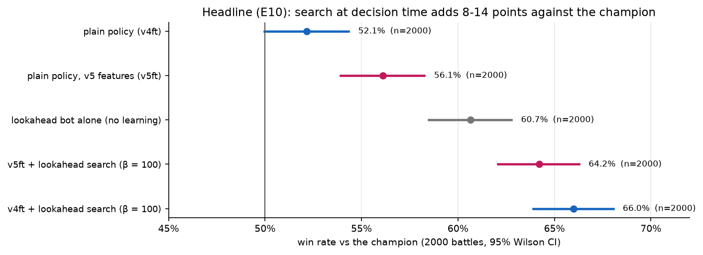

**Strongest bot (E10): `checkpoints/v5ft/final.zip` + one-turn lookahead search** (`--search-beta 100`).
It beats the previous champion **64.2%** [62.1, 66.3] over 2000 battles; the plain v5ft policy beats it 56.1%.
Play it with `.venv/bin/python -m pokebot.play --model checkpoints/v5ft/final.zip --search-beta 100`.

**The champion** (`checkpoints/champion.zip`, the reference model for every head-to-head): v2 features,
PPO from scratch, 4M steps (about 2.5 hours of training on 4 in-process envs). Over 500 battles per opponent:

| opponent | win rate (95% CI) |
|---|---|
| RandomPlayer | 98.6% [97.1, 99.3] |
| MaxBasePowerPlayer | 92.0% [89.3, 94.1] |
| HeuristicBot (`bots/heuristic_bot.py`) | 73.2% [69.2, 76.9] |
| SimpleHeuristicsPlayer | 70.6% [66.5, 74.4] |
| first RL agent (v1, 3M steps), head-to-head | 65.2% [60.9, 69.2] |

Play it with `.venv/bin/python -m pokebot.play --model checkpoints/champion.zip --verbose`.

**What mattered, in order** (details and every number in `docs/DECISIONS.md`):
1. **Search at decision time** (E10): +8 to +14 points against the champion, on top of any trained policy.
2. **Better input features** (v2, E5): +15 points against SimpleHeuristics at equal steps, the biggest gain from RL alone.
3. **More self-play** (E6): +6 points from 1M to 4M steps.
4. **The search's scores as inputs** (v5, E10): +4 points over a matched control.
5. Behaviour cloning (E4), items/crits/memory (v3, E7), abilities (v4, E8) and league training (E9):
   no measurable gain at the ceiling, each tested against a matched control.

## Figures

All figures are rebuilt from the training logs by `scripts/make_figures.py`. Their data is committed in
`results/`: the TensorBoard curves of every run as CSV, and every evaluation with its source log.

| | |
|---|---|
| 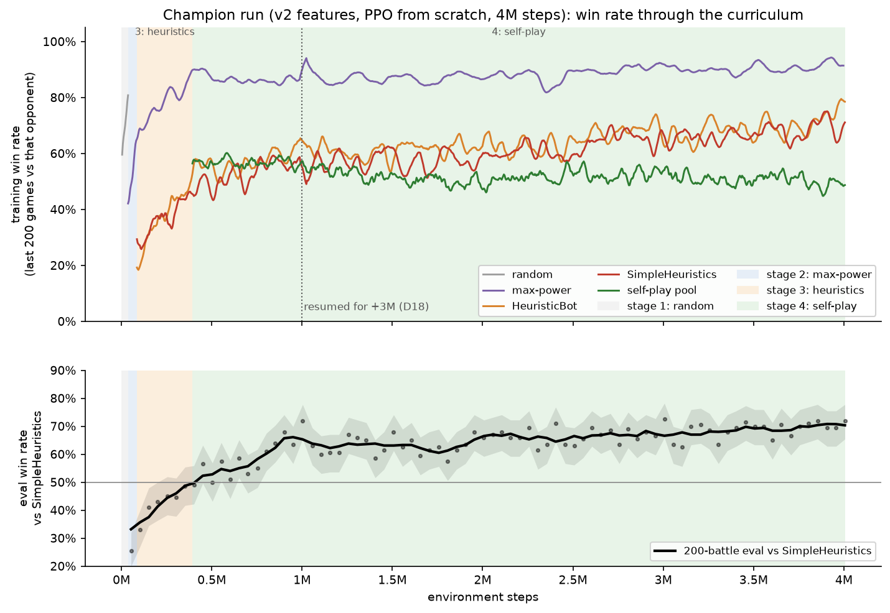 | 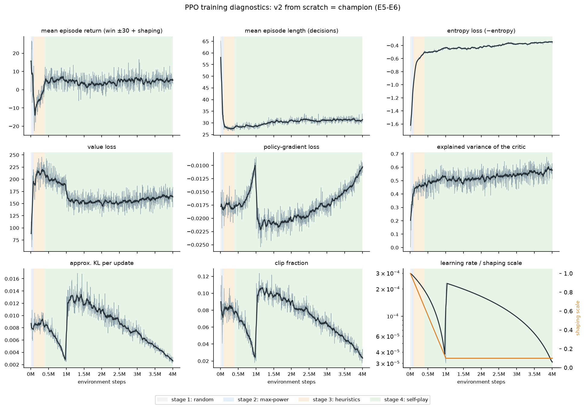 |
| **1. Champion run through the curriculum.** Training win rate against each opponent type (last 200 games) through the four stages, and the 200-battle eval against SimpleHeuristics with its 95% CI. | **2. PPO diagnostics of the champion run.** Return, episode length, entropy, value and policy losses, explained variance, KL, clip fraction, LR and shaping schedules. The jump at 1M is the resume with a re-warmed LR (D18). |
| 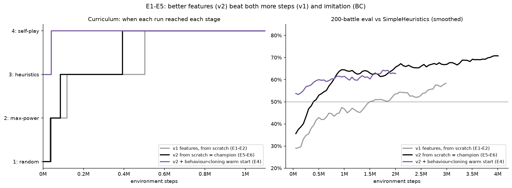 | 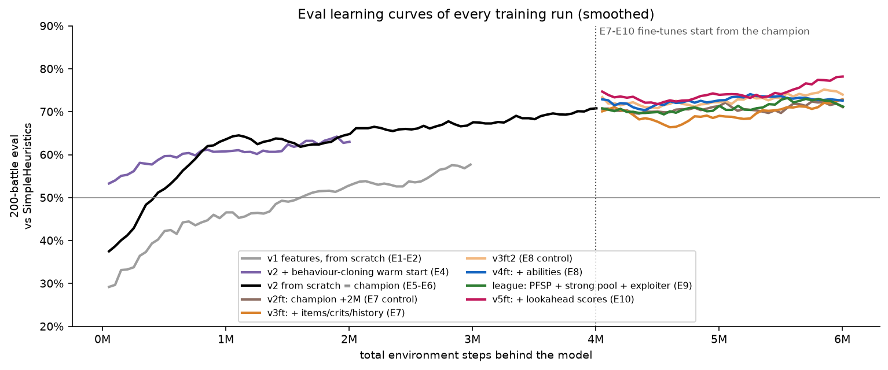 |
| **3. E1-E5: v1 vs v2 features vs a behaviour-cloning warm start.** v2 clears the curriculum faster and reaches a higher eval; BC starts high but doesn't end higher. | **4. Eval curves of every run** by total training steps behind the model. The E7-E10 fine-tunes continue from the champion's 4M steps. |
| 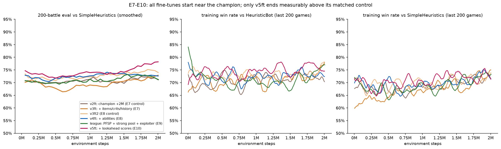 | 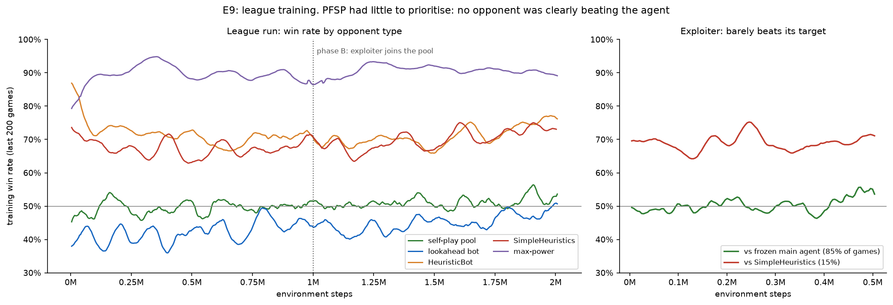 |
| **5. E7-E10 fine-tunes** (2M steps each, from the champion's weights): eval and training win rates. Only v5ft separates from the pack. | **6. E9 league training**: win rate by opponent type (self-play pool, lookahead bot, scripted bots), and the exploiter trained against the main agent. |
| 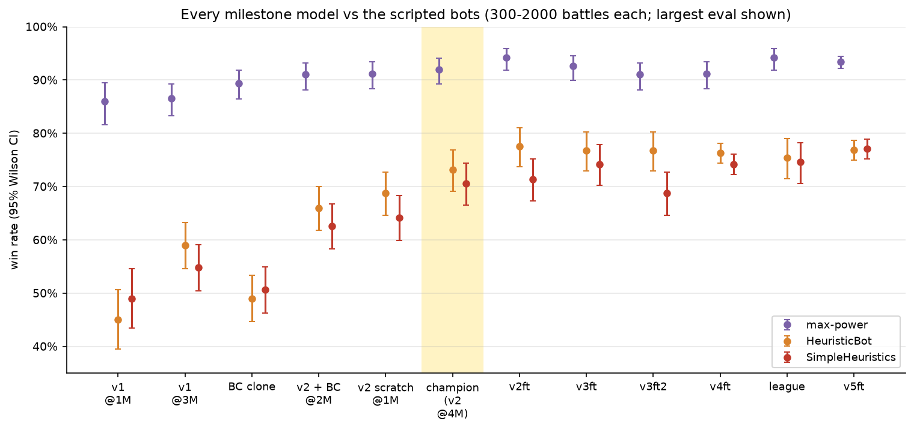 | 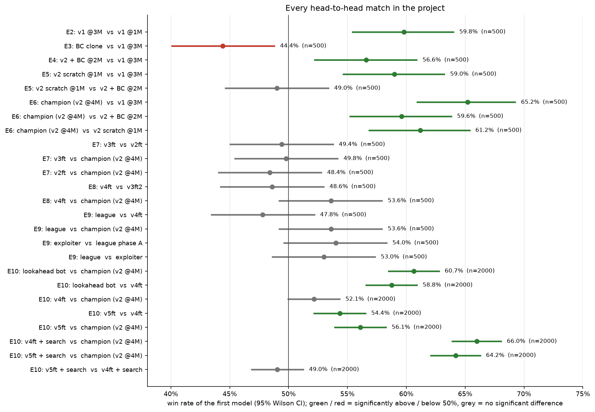 |
| **7. Every milestone model vs the scripted bots** (300-2000 battles each, 95% CIs). | **8. Every head-to-head match in the project**, coloured by significance. |
| 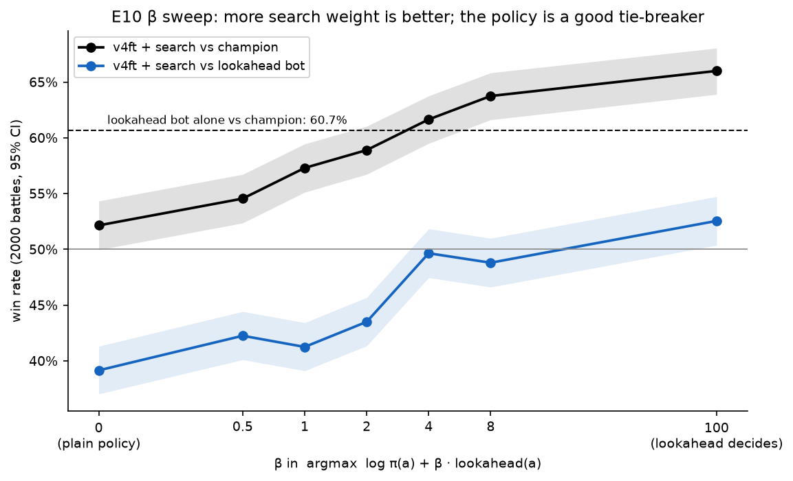 | 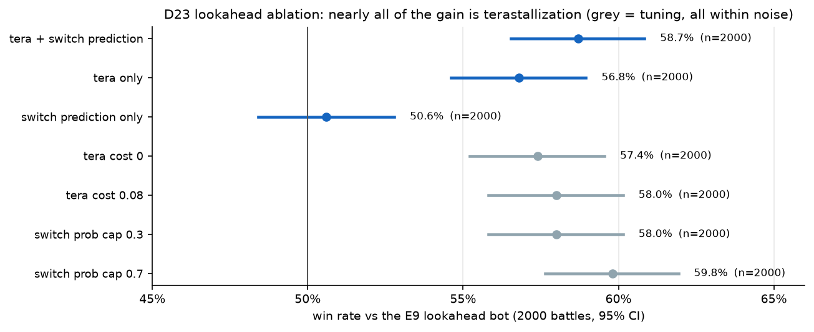 |
| **9. E10 β sweep** for `argmax log π(a) + β · lookahead(a)`: more search weight is better, and the policy breaks ties better than the lookahead alone. | **10. D23 lookahead ablation**: terastallization gives almost all of the gain; switch prediction and tuning are within noise. |
| 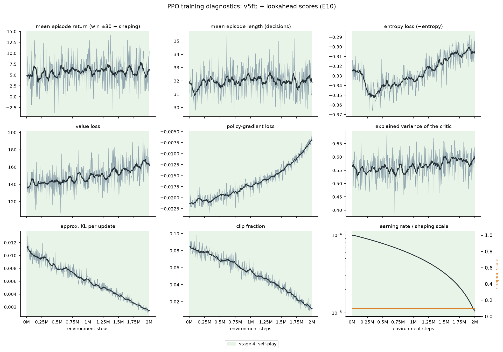 | |
| **11. PPO diagnostics of v5ft**, the strongest plain policy. | |

Rebuild them (reads `logs/<run>/` TensorBoard files if present, else the committed CSVs):

```bash
.venv/bin/python scripts/make_figures.py
```

## Setup

Requirements: Python 3.12, Node.js (tested with v26), and macOS or Linux.

**1. Showdown server.** It is a separate checkout of [smogon/pokemon-showdown](https://github.com/smogon/pokemon-showdown) in `pokemon-showdown/` (not tracked in this repo). The random-battle set data in it is also read by the v2+ features. Set it up once, pinned to the commit this project was built against:

```bash
scripts/setup_showdown.sh                   # clone + npm install + config (first time only)
cd pokemon-showdown
node pokemon-showdown start --no-security   # serves http://localhost:8000
```

`--no-security` turns off authentication, so bots and humans can log in with any name and
no password. Keep the server running in its own terminal while you train, evaluate or play.

> Note: the setup script sets `exports.repl = false` in `pokemon-showdown/config/config.js`. The project path
> is long, and that made the REPL socket path too long for macOS (Unix socket paths have a
> length limit), which broke server startup. The REPL is only a debugging aid, so turning it
> off is harmless.

**2. Python environment:**

```bash
python3.12 -m venv .venv
.venv/bin/pip install poke-env==0.17.0 stable-baselines3==2.9.2 sb3-contrib==2.9.2 \
    gymnasium torch tensorboard pytest matplotlib pandas
```

Run every command from the project root with `.venv/bin/python`.

## Layout

```
bots/heuristic_bot.py   hand-written damage/matchup heuristic bot (baseline + example poke-env Player)
bots/lookahead_bot.py   one-turn lookahead bot on the v2-v4 damage model, with tera and switch prediction
                        (the strongest scripted opponent; `LookaheadScorer` is its scoring half)
pokebot/search.py       policy + search: argmax log pi(a) + beta * lookahead(a) at decision time
pokebot/features_v5.py  v5 features: v4 + the lookahead's score for every action -> 804 floats
pokebot/config.py       shared constants: BATTLE_FORMAT, ACTION_SPACE_SIZE=26, RewardConfig, dirs
pokebot/INTERFACE.md    module contract shared by all the pokebot modules
pokebot/features.py     v1 features: embed_battle(battle) -> 226 floats (frozen; v1 checkpoints use it)
pokebot/features_v2.py  v2 features: v1 + damage-%/KO flags, opponent movepool threats, switch-in
                        matchups, opponent team, history -> 346 floats (default for new runs)
pokebot/features_v3.py  v3 features: v2 + held items, critical hits, battle history / past decisions -> 635 floats
pokebot/v3_items.py     v3 item + crit blocks (item priors, Choice lock, item-aware damage, crit pricing)
pokebot/v3_history.py   v3 memory block (last 6 turns, whole-battle tallies, previous action)
pokebot/features_v4.py  v4 features: v3 + abilities -> 752 floats
pokebot/v4_abilities.py v4 ability block (effects, immunities, residual damage, weather on switch-in, Intimidate)
pokebot/surgery.py      widen a trained model's input layer for a bigger feature set (starts identical)
pokebot/feature_sets.py registry: version <-> obs size; PolicyPlayer auto-detects a checkpoint's version
pokebot/bc.py           behavior cloning: record a teacher bot's battles, train a policy to imitate it
docs/DECISIONS.md       design & decision log with every experiment and its results (start here to learn)
docs/figures/           every figure (learning curves, diagnostics, evals, ablations), made by scripts/make_figures.py
results/curves/         TensorBoard scalars of every training run as CSV (step, win rates, losses, schedules)
results/evals.csv       every evaluation and head-to-head: model, opponent, wins, battles, source log
scripts/                run_e7..e10.sh experiment pipelines, make_figures.py, setup_showdown.sh
data/                   recorded teacher battles for behavior cloning
pokebot/env.py          PokeBotEnv / MaskedPokeEnv (Gymnasium env with action masks),
                        make_env, make_opponent, PolicyPlayer (a Player driven by a checkpoint)
pokebot/train.py        MaskablePPO training: curriculum, reward annealing, self-play, checkpoints
pokebot/evaluate.py     win rate + 95% CI against the baseline bots, checkpoint vs checkpoint
pokebot/play.py         put the bot online so a human can challenge it (or have it challenge you)
tests/                  pytest tests
checkpoints/<run>/      saved models (created by training; champion.zip, the E7-E10 finals and the
                        v3/v4/v5 warm starts are tracked in git)
logs/<run>/             TensorBoard logs (created by training)
```

## Commands

### Training

```bash
# Smoke test: a tiny run that checks the whole pipeline end to end
.venv/bin/python -m pokebot.train --smoke --run-name smoke

# Real training run
.venv/bin/python -m pokebot.train --timesteps 2000000 --n-envs 4 --run-name run1

# Resume from a checkpoint
.venv/bin/python -m pokebot.train --timesteps 2000000 --n-envs 4 --run-name run1 \
    --resume checkpoints/run1/<checkpoint>.zip
```

Full CLI: `python -m pokebot.train --timesteps N --n-envs K --run-name NAME [--resume PATH] [--smoke]
[--features v1|v2|v3|v4] [--init-from PATH] [--start-stage 1-4] [--lr X] [--shaping-start X --shaping-end Y]`.

**When resuming**, the learning-rate and shaping schedules are computed over the *new* call, so pass
`--shaping-start 0.1 --shaping-end 0.1` (and the run's `--lr`) to avoid re-inflating them — see
`docs/DECISIONS.md` D14.

### Behavior cloning warm start ("SFT before RL")

```bash
# 1) record 10k battles of SimpleHeuristicsPlayer (~3 min)
.venv/bin/python -m pokebot.bc collect --battles 10000 --out data/bc_v2_10k.npz
# 2) supervised training of policy + value heads (~5 min)
.venv/bin/python -m pokebot.bc train --data data/bc_v2_10k.npz --out checkpoints/bc_v2/bc.zip --epochs 20 --vf-weight 0.05
# 3) PPO fine-tuning from those weights, skipping the easy curriculum stages
.venv/bin/python -m pokebot.train --run-name v2bc --init-from checkpoints/bc_v2/bc.zip --start-stage 3 --lr 1e-4 --timesteps 2000000
```

Training is safe to run on a laptop. It uses a few CPU cores and a modest amount of memory,
and you can stop it at any time and resume later. Long runs keep the CPU busy for hours, so
**keep the laptop plugged in** and somewhere it can stay cool. Use a lower `--n-envs` if
the machine gets hot.

### v3 features: warm start from the champion (trained in E7: no gain over the champion yet)

```bash
# widen the champion's input layer 346 -> 635 (already done: checkpoints/v3_init/init.zip)
.venv/bin/python -m pokebot.surgery --src checkpoints/champion.zip --obs-size 635 --out checkpoints/v3_init/init.zip
# fine-tune it with the new features (see docs/DECISIONS.md E7 for the matched v2 control run)
.venv/bin/python -m pokebot.train --run-name v3ft --features v3 --init-from checkpoints/v3_init/init.zip \
    --start-stage 4 --lr 1e-4 --shaping-start 0.1 --shaping-end 0.1 --timesteps 2000000 --n-envs 4
```

### v4 features: abilities (trained in E8: no gain over the champion yet)

```bash
# widen the v3 fine-tune 635 -> 752 (already done: checkpoints/v4_init/init.zip)
.venv/bin/python -m pokebot.surgery --src checkpoints/v3ft/final.zip --obs-size 752 --out checkpoints/v4_init/init.zip
# fine-tune with ability features (see docs/DECISIONS.md E8 for the matched v3 control run)
.venv/bin/python -m pokebot.train --run-name v4ft --features v4 --init-from checkpoints/v4_init/init.zip \
    --start-stage 4 --lr 1e-4 --shaping-start 0.1 --shaping-end 0.1 --timesteps 2000000 --n-envs 4
```

### League training: stronger opponents (trained in E9: no gain over v4ft yet)

The final training stage can take a custom opponent mix (`--opponent-mix`), keep strong checkpoints in
the self-play pool for the whole run (`--pool-extra`), and pick pool opponents by how often the bot
loses to them (`--pfsp`). Mix keys: `pool`, `random`, `maxpower`, `heuristic`, `simple_heuristic`,
`lookahead`, or `policy:<checkpoint.zip>`. The full E9 pipeline (main agent, exploiter, second half,
evals) is `scripts/run_e9.sh`; see docs/DECISIONS.md D22 and E9.

```bash
.venv/bin/python -m pokebot.train --run-name league --features v4 --init-from checkpoints/v4_init/init.zip \
    --start-stage 4 --lr 1e-4 --shaping-start 0.1 --shaping-end 0.1 --timesteps 2000000 --n-envs 4 \
    --pfsp --opponent-mix "pool=0.55,lookahead=0.20,heuristic=0.10,simple_heuristic=0.10,maxpower=0.05" \
    --pool-extra checkpoints/champion.zip,checkpoints/v3ft/final.zip
```

### Search: the lookahead inside the bot (E10)

Policy + lookahead at β = 100 beats the champion 64–66%; v5 features beat the matched v4 run 54.4%.
See docs/DECISIONS.md D23–D25 and E10.

```bash
# play a checkpoint as policy + one-turn lookahead (beta 0 = plain policy, large beta = pure lookahead)
.venv/bin/python -m pokebot.evaluate --model checkpoints/v4ft/final.zip --search-beta 100 --opponents lookahead --battles 2000
# v5 = v4 + the lookahead's score for each action, warm-started from v4_init (scripts/run_e10.sh)
.venv/bin/python -m pokebot.surgery --src checkpoints/v4_init/init.zip --obs-size 804 --out checkpoints/v5_init/init.zip
.venv/bin/python -m pokebot.train --run-name v5ft --features v5 --init-from checkpoints/v5_init/init.zip \
    --start-stage 4 --lr 1e-4 --shaping-start 0.1 --shaping-end 0.1 --timesteps 2000000 --n-envs 4 --torch-threads 1
```

Lookahead variants for comparisons: `lookahead` (tera + switch prediction), `lookahead1` (the E9
bot), `lookahead_tera`, `lookahead_switch`.

### TensorBoard

```bash
.venv/bin/tensorboard --logdir logs      # then open http://localhost:6006
```

### Evaluation

```bash
# Sanity check with no model: the heuristic bot against all baselines
.venv/bin/python -m pokebot.evaluate --model heuristic --battles 20

# A checkpoint against random, maxpower, heuristic and simple_heuristic (200 battles each)
.venv/bin/python -m pokebot.evaluate --model checkpoints/run1/<checkpoint>.zip

# Choose opponents and save replays
.venv/bin/python -m pokebot.evaluate --model ckpt.zip --opponents heuristic,simple_heuristic \
    --battles 100 --save-replays replays/

# Pit two checkpoints against each other
.venv/bin/python -m pokebot.evaluate --model new.zip --compare old.zip --battles 200
```

Options: `--battles N` (per opponent, default 200), `--opponents a,b,...`,
`--concurrency N` (default 10), `--save-replays DIR`, `--compare PATH2`, `--stochastic`
(sample actions instead of always picking the most likely one). `--model` also accepts a
baseline name (`random`, `maxpower`, `heuristic`, `simple_heuristic`, `lookahead`, `lookahead1`,
`lookahead_tera`, `lookahead_switch`); the lookahead bots are not in the default opponent list, so
pass them with `--opponents`. `--search-beta B` / `--compare-search-beta B` play a checkpoint as
policy + lookahead (`pokebot/search.py`). The output table shows
wins/battles, win rate, a 95% Wilson confidence interval and the mean battle length in turns.

### Playing against the bot

```bash
.venv/bin/python -m pokebot.play --model checkpoints/run1/<checkpoint>.zip
```

Then open http://localhost:8000 and click **Choose name** to pick any name (no password).
Click **Find a user**, enter `PokeBotRL`, then **Challenge**, and pick
**[Gen 9] Random Battle**.

- `--username NAME` changes the bot's name (default `PokeBotRL`)
- `--n-challenges N` sets how many battles to play before exiting (default 1; `0` means forever)
- `--challenge USER` makes the bot challenge you instead (you must be logged in as USER first)
- `--verbose` prints each turn's chosen action and the policy's top-3 action probabilities
- `--model heuristic` plays the scripted bot instead of a checkpoint

## How it works

- **Observation**: `features.embed_battle` turns the battle state into a fixed-size float
  vector, with every entry clipped to [-1, 1]. It covers both active Pokémon (HP, types,
  base stats, boosts, status), the four moves (power, type, category, effectiveness), the
  bench, weather, terrain, hazards and tera availability. The vector is built from
  fixed-size blocks, and any block that hits missing information is left as zeros, so the
  function never fails.
- **Actions**: poke-env's 26-action singles space. Actions 0–5 switch to a team slot, 6–9
  use a move, 22–25 use a move and terastallize, and 10–21 (mega, Z-move, dynamax) are never
  legal in gen 9. Every turn, an action mask marks the illegal actions, and `MaskablePPO`
  only samples legal ones.
- **Reward**: potential-based shaping, `shaping_scale * [Φ(s') − Φ(s)]`. Φ combines HP,
  faint and status differences between the two sides. A terminal ±victory bonus is added at
  the end. Potential-based shaping leaves the optimal policy unchanged. `shaping_scale` is
  annealed toward ~0.1 during training, so later on the agent optimises mostly for winning.
- **Learning**: `MaskablePPO` (sb3-contrib) runs over several parallel environments. Each
  environment is a live battle on the local server against an opponent driven in the same
  process.
- **Curriculum → self-play**: opponents get harder in stages: `RandomPlayer` →
  `MaxBasePowerPlayer` → the heuristic bots (`HeuristicBot`, `SimpleHeuristicsPlayer`) → a
  self-play pool of the agent's own past checkpoints, mixed with baselines so it doesn't
  forget how to beat them. Training periodically measures the win rate against the baselines
  and logs it to TensorBoard.
